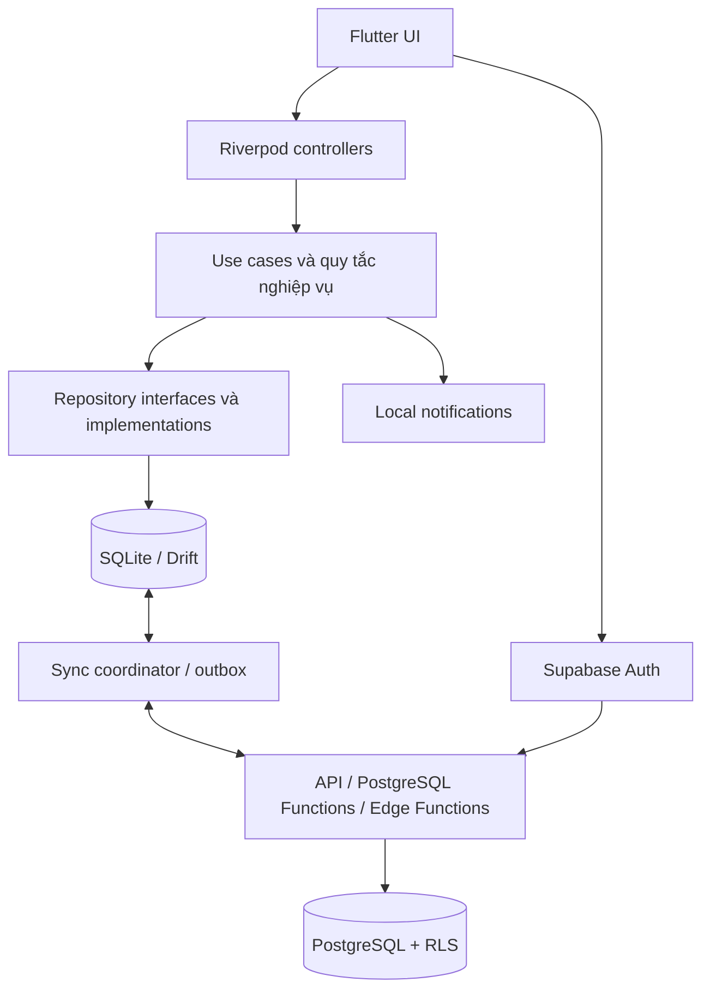

# Kiến trúc project — App nhắc uống nước

- Ngày cập nhật: 28/10/2026
- Phiên bản: 0.1
- Trạng thái: Kiến trúc đề xuất, chưa được phê duyệt triển khai.
- Nguồn yêu cầu: [requirements.md](requirements.md).

## 1. Định hướng

Một app Flutter cho iOS/Android, một backend chung và PostgreSQL. Chia mã theo nghiệp vụ, hỗ trợ ghi nhận offline và đồng bộ sau. Giai đoạn đầu không cần microservices.

Trạng thái hiện tại của repository là bản thử nghiệm web HTML/CSS/JavaScript. Cấu trúc Flutter/Supabase bên dưới chưa được tạo; việc giữ, di chuyển hoặc thay thế bản thử nghiệm cần phạm vi triển khai được duyệt riêng.

## 2. Stack đề xuất

| Thành phần | Lựa chọn | Trách nhiệm |
| --- | --- | --- |
| App | Flutter / Dart | Giao diện và logic dùng chung iOS/Android. |
| Trạng thái và kết nối phụ thuộc | Riverpod | Điều phối trạng thái giao diện và cung cấp thành phần. Cubit là lựa chọn thay thế chưa chốt. |
| Local database | Drift / SQLite | Lịch sử local, bộ nhớ đệm theo tài khoản, hàng đợi đồng bộ. |
| Backend | Supabase | Auth, API, database và các dịch vụ cần thiết. |
| Server database | PostgreSQL | Dữ liệu nghiệp vụ dùng chung, giao dịch và phân quyền. |
| Logic backend | PostgreSQL Functions / Edge Functions | Xác thực thay đổi, phần thưởng, liên kết các thao tác đặc quyền. |
| Thông báo | flutter_local_notifications | Đặt/hủy lịch trực tiếp trên thiết bị. |
| Đồ họa | Tài nguyên tự thiết kế + animation Flutter | Thú 2D và phản hồi tương tác. |
| Tài nguyên từ xa | Supabase Storage nếu cần | Tài nguyên hoặc ảnh được tải từ backend. |

Không cần Rive cho MVP. Nếu bổ sung sau, phải kiểm tra riêng runtime, công cụ biên tập và quyền sử dụng tài nguyên.

Ưu tiên giấy phép cho phép dùng thương mại, không thu phí bản quyền theo doanh thu. Việc duyệt giấy phép phải thực hiện trên phiên bản và phụ thuộc thực tế khi chốt gói; danh sách này không thay thế kiểm tra đó. Supabase tự triển khai vẫn cần chi phí hạ tầng, cập nhật và backup.

## 3. Sơ đồ tổng thể



Riverpod không phải database, backend hoặc cơ chế đồng bộ. Domain không phụ thuộc Riverpod, Flutter, SQLite hoặc Supabase. Implementation ở lớp data phụ thuộc vào interface của domain.

## 4. Cấu trúc repository dự kiến

```text
drink-water-remind/
├── apps/
│   └── mobile/
│       ├── android/
│       ├── ios/
│       ├── assets/
│       │   ├── pets/
│       │   ├── images/
│       │   └── sounds/
│       ├── lib/
│       │   ├── app/
│       │   │   ├── bootstrap/
│       │   │   ├── routing/
│       │   │   └── theme/
│       │   ├── core/
│       │   │   ├── database/
│       │   │   ├── network/
│       │   │   ├── sync/
│       │   │   ├── notifications/
│       │   │   ├── time/
│       │   │   └── errors/
│       │   ├── shared/
│       │   │   └── widgets/
│       │   └── features/
│       │       ├── auth/
│       │       ├── onboarding/
│       │       ├── profile/
│       │       ├── hydration/
│       │       ├── reminders/
│       │       ├── pets/
│       │       ├── rewards/
│       │       ├── insights/
│       │       └── settings/
│       ├── test/
│       └── integration_test/
├── supabase/
│   ├── migrations/
│   ├── functions/
│   ├── tests/
│   └── seed.sql
├── infra/
│   └── self-host/
├── document/
│   ├── requirements.md
│   ├── architecture.md
│   └── decisions/              # Tạo khi có quyết định cần ghi lại
└── AGENTS.md
```

Chỉ tạo thư mục/lớp khi có chức năng sử dụng. `core` chứa hạ tầng dùng chung, không gom quy tắc nghiệp vụ của mọi tính năng vào đây. Tài liệu thống nhất nằm trong `document/` theo yêu cầu người dùng.

## 5. Ranh giới nghiệp vụ

| Mô-đun | Phạm vi |
| --- | --- |
| auth | Phiên đăng nhập, nhà cung cấp, liên kết danh tính, đăng xuất/xóa tài khoản. |
| onboarding | Thiết lập ban đầu, giới thiệu quyền thông báo và chọn bạn đồng hành. |
| profile | Thông tin cá nhân, đầu vào tính mục tiêu. |
| hydration | Mục tiêu ngày, lần uống, tổng lượng nước và quy tắc chỉnh sửa. |
| reminders | Khung giờ, phân bổ lịch, hoãn/bỏ qua và thiết bị nhận nhắc. |
| pets | Thú sở hữu, lựa chọn và trạng thái hiển thị. |
| rewards | Điều kiện thưởng, chống trùng, phiên bản quy tắc và điều chỉnh thưởng. |
| insights | Lịch sử, thống kê; đọc dữ liệu, không sở hữu luồng ghi nhận. |
| settings | Tùy chọn app, quyền và trạng thái đồng bộ. |

Ví dụ bên trong `hydration`:

```text
hydration/
├── presentation/
│   ├── screens/
│   ├── widgets/
│   └── controllers/
├── domain/
│   ├── models/
│   ├── repositories/
│   └── use_cases/
└── data/
    ├── local/
    ├── remote/
    └── repositories/
```

Các use case dự kiến: `RecordWaterIntake`, `UpdateWaterIntake`, `DeleteWaterIntake`, `SetDailyGoal`, `BuildReminderSchedule`. Không tạo use case chỉ để bọc một hàm mà không đem lại ranh giới hữu ích.

## 6. Luồng ghi nhận

1. UI gửi dung tích và thời gian cho use case.
2. Kiểm tra đầu vào theo quy tắc đã duyệt.
3. Trong một giao dịch SQLite, ghi lần uống và tác vụ outbox.
4. UI quan sát local database để cập nhật ngay tiến độ và phản hồi thú.
5. Tính lại lịch nhắc, hủy/thay các mốc không còn hợp lệ.
6. Bộ đồng bộ gửi thay đổi khi có mạng và phiên hợp lệ.
7. Backend kiểm tra quyền sở hữu, chống trùng và xử lý phần thưởng trong giao dịch thích hợp.
8. App nhận dữ liệu đã xác nhận, cập nhật local và trạng thái đồng bộ.

Hoạt ảnh phản hồi có thể chạy tức thời; tiến độ phần thưởng offline là tạm thời cho đến khi server xác nhận. Cách hiển thị khi bị điều chỉnh cần thiết kế rõ, tránh cộng thưởng hai lần.

## 7. Thiết kế đồng bộ

### 7.1. Nguyên tắc

- Local database là nguồn đọc chính cho UI; backend là nguồn dữ liệu hợp nhất giữa thiết bị.
- Mỗi bản ghi/lệnh có ID duy nhất; retry không tạo hiệu ứng trùng.
- Ghi dữ liệu và outbox cùng giao dịch để không có bản ghi bị bỏ quên.
- Khi server xác nhận nhưng kết nối mất trước khi app nhận phản hồi, retry vẫn an toàn.
- Cách ly dữ liệu, outbox và con trỏ đồng bộ theo tài khoản.
- Đồng bộ lúc mở app, trở lại foreground, sau thay đổi và khi kết nối trở lại; background là bổ trợ, không phải bảo đảm.
- Có trạng thái đang chờ, đang đồng bộ và lỗi cần xử lý.
- Không coi Supabase Realtime là cơ chế đồng bộ offline hoàn chỉnh.

### 7.2. Sửa, xóa và xung đột

- Đề xuất phiên bản bản ghi do server quản lý; không chỉ dựa vào đồng hồ điện thoại.
- Sửa/xóa gửi kèm phiên bản đã biết; khi xung đột, tải bản mới và xử lý theo chính sách từng loại dữ liệu.
- Dùng dấu xóa được đồng bộ; không xóa vật lý ngay khiến thiết bị khác tạo lại bản ghi.
- Pull dùng con trỏ/chuỗi thay đổi phía server có thứ tự ổn định; chi tiết giao thức cần thiết kế khi triển khai.
- Không tải đè dữ liệu đang có thay đổi local chưa được giải quyết.
- Không cho client ghi trực tiếp tổng XP; backend suy ra/đối chiếu từ sự kiện thưởng.
- Quy tắc thu hồi hoặc bù thưởng khi sửa/xóa lần uống cần quyết định trước khi hoàn thiện schema.

Chưa cần dịch vụ sync bên thứ ba ở MVP. Nếu độ phức tạp tăng, đánh giá riêng giải pháp đồng bộ và giấy phép/chi phí trước khi thêm.

## 8. Mô hình dữ liệu dự kiến

| Bảng/nhóm | Nội dung |
| --- | --- |
| Auth users / identities | Do hệ thống xác thực quản lý; liên kết các nhà cung cấp với ID tài khoản. |
| profiles | Tuổi/thông tin ngày sinh theo quyết định thu thập, giới tính, cân nặng, chiều cao. |
| hydration_preferences | Khung giờ, dung tích mặc định, múi giờ và tùy chọn. |
| daily_goals | Chủ sở hữu, ngày áp dụng, lượng mục tiêu, nguồn nhập tay/gợi ý, phiên bản phương pháp. |
| water_intakes | ID, chủ sở hữu, dung tích, thời điểm UTC, ngữ cảnh ngày/múi giờ, phiên bản, dấu xóa. |
| user_pets | Thú sở hữu, lựa chọn hiện tại và tiến độ được server xác nhận. |
| reward_events | Nguồn phát sinh, loại thưởng, phiên bản quy tắc, giá trị và sự kiện điều chỉnh nếu có. |
| devices | Thiết bị của tài khoản và cấu hình nhận nhắc; token push chỉ thêm khi có nhu cầu. |
| Local outbox | ID tác vụ, tài khoản, nội dung, phiên bản gốc, trạng thái và số lần thử. |
| Local sync state | Con trỏ đồng bộ, thời điểm xác nhận và trạng thái theo tài khoản. |

Đây là mô hình khái niệm, chưa phải migration. Cần chốt tính duy nhất, index, retention, cách xử lý ngày/múi giờ và hợp nhất tài khoản trước khi tạo schema.

## 9. Xác thực và phân quyền

- Supabase Auth làm đầu mối cho Google, Apple và Facebook.
- Dữ liệu liên kết bằng user ID, không phải email; hỗ trợ Apple ẩn email.
- Cấu hình OAuth, callback/deep link, application ID và thông tin nhà cung cấp riêng cho từng môi trường.
- Chỉ xin quyền tối thiểu phục vụ đăng nhập, không xin đọc hộp thư.
- Liên kết danh tính yêu cầu phiên hợp lệ và xác thực phương thức mới; không gộp bằng email đơn thuần.
- Hai tài khoản đã có dữ liệu cần thao tác hợp nhất riêng ở backend, xử lý xung đột và chống thưởng trùng.
- Token phiên lưu bằng kho bảo mật của nền tảng. Provider secrets và khóa quản trị chỉ ở server.
- Bật RLS và kiểm tra quyền cho dữ liệu người dùng; endpoint đặc quyền phải kiểm tra chủ thể gọi.
- Khi đăng xuất, xử lý thay đổi chưa đồng bộ theo chính sách đã chốt; không âm thầm làm mất dữ liệu hoặc trộn tài khoản.
- Xóa tài khoản được điều phối trên server; xóa dữ liệu local, thu hồi phiên và ngăn outbox cũ phục hồi dữ liệu đã xóa.

Đề xuất MVP: lần đăng nhập đầu tiên cần mạng; sau đó cho phép đọc/ghi local trong khi offline, việc đồng bộ chờ phiên hợp lệ. Hành vi khi phiên bị thu hồi sẽ được hoàn thiện cùng đặc tả bảo mật.

## 10. Nhắc nhở và thời gian

- Đặt local notification trong cửa sổ hữu hạn, bổ sung/tính lại khi app có cơ hội hoạt động.
- Thông báo có ID ổn định để thay lịch và tránh trùng.
- Xử lý quyền thông báo, đổi múi giờ, thay đổi giờ hệ thống, khởi động lại máy và giới hạn từng nền tảng.
- Lịch tương lai có thể tính lại; lịch sử phải giữ ngữ cảnh thời gian đã xác định.
- Thiết bị chính là đề xuất cho MVP; server lưu lựa chọn và app cập nhật lịch khi nhận được trạng thái mới.
- Thiết bị cũ offline có thể vẫn nhắc theo lịch đã đặt; không hứa hủy tức thời từ xa.
- Chưa cần push server cho lời nhắc uống nước cơ bản. Nếu bổ sung, có quy tắc tránh trùng với local notification.

Thuật toán chia lịch, số mốc, khoảng cách tối thiểu và cách xử lý mục tiêu còn nhiều vào cuối ngày cần được duyệt trong đặc tả reminders.

## 11. Vận hành và phát hành

- Tách development, staging và production về database, Auth, nhà cung cấp đăng nhập và cấu hình app.
- Quản lý schema bằng migration có phiên bản; kiểm thử nâng cấp local database và server.
- Với Supabase tự triển khai: có người chịu trách nhiệm HTTPS, cập nhật, backup, giám sát và phục hồi thử nghiệm.
- Không lưu secrets trong Git hoặc ghi token/thông tin hồ sơ vào log.
- CI dự kiến chạy phân tích mã, test nghiệp vụ, test database/RLS và build kiểm tra.
- Chuẩn bị môi trường macOS/Xcode hoặc dịch vụ build phù hợp cho iOS; công cụ build và tài khoản phát hành là quyết định vận hành riêng.
- Mốc triển khai server hoặc phát hành store cần được người dùng cho phép trong phạm vi cụ thể.

## 12. Chiến lược kiểm thử

| Cấp độ | Luồng trọng tâm |
| --- | --- |
| Unit | Tính mục tiêu, chia lịch, ngày/múi giờ, điều kiện thưởng và điều chỉnh thưởng. |
| Local integration | Migration, transaction ghi intake + outbox, cách ly tài khoản. |
| Backend | RLS, xác thực endpoint, retry chống trùng, xung đột và xóa tài khoản. |
| End-to-end | Ghi offline rồi online; mất mạng sau server commit; đổi máy; sửa/xóa đa thiết bị. |
| Thiết bị thật | Đăng nhập ba nhà cung cấp, callback, quyền thông báo, đóng app, reboot và đổi múi giờ. |

## 13. Hướng mở rộng

- Loại đồ uống mới: mở rộng hydration và phương pháp tính, giữ phiên bản quy tắc.
- Nhiệm vụ/vật phẩm: mở rộng rewards và pets, backend xác nhận quyền sở hữu.
- Gói trả phí: thêm mô-đun thanh toán/quyền sử dụng, xác nhận trên backend.
- Health integrations: thêm adapter cho Apple Health/Health Connect, chống nhập dữ liệu trùng.
- Thử thách nhóm: mô-đun riêng trên backend, không thay đổi trách nhiệm của ghi nhận nước.
- Chỉ bổ sung API server riêng khi có nhu cầu cụ thể; giữ repository interface để giảm tác động lên app.

## 14. Quyết định cần duyệt trước triển khai

1. Stack cuối cùng: Riverpod hay Cubit; Supabase tự triển khai hay được quản lý.
2. Quy tắc mục tiêu, lịch nhắc, phần thưởng và dữ liệu thời gian.
3. Giao thức đồng bộ, xử lý xung đột và chính sách dữ liệu khi đăng xuất/xóa tài khoản.
4. Phạm vi MVP của liên kết/hợp nhất tài khoản và thiết bị nhận nhắc.
5. Kế hoạch xử lý bản thử nghiệm web hiện có.
6. Ngân sách, người vận hành và môi trường phát hành.

## 15. Tài liệu tham khảo

Triển khai giai đoạn 2 (29/10/2026): đã chọn Riverpod và Supabase tự triển khai. Database local tách theo tài khoản, outbox dùng command ID và revision; xung đột dùng bản server, đăng xuất giữ cache riêng và trở về khách. Chi tiết quyết định đã triển khai: [sync-protocol.md](sync-protocol.md). Cấu hình provider còn thiếu: [oauth-setup.md](oauth-setup.md). Các hạng mục chưa triển khai trong kiến trúc đích như hợp nhất hai tài khoản, xóa tài khoản, thiết bị nhắc chính và server rewards vẫn là kế hoạch.

Các nguồn đã được tham khảo trong quá trình thảo luận; cần kiểm tra lại phiên bản và điều kiện khi triển khai:

- [Flutter: platform integration](https://docs.flutter.dev/platform-integration)
- [Flutter FAQ và giấy phép](https://docs.flutter.dev/resources/faq)
- [Riverpod](https://riverpod.dev/)
- [Giấy phép Riverpod](https://pub.dev/packages/flutter_riverpod/license)
- [Drift setup](https://drift.simonbinder.eu/setup/)
- [Giấy phép Drift](https://pub.dev/packages/drift/license)
- [Supabase Auth](https://supabase.com/docs/guides/auth)
- [Supabase RLS](https://supabase.com/docs/guides/database/postgres/row-level-security)
- [Supabase self-hosting](https://supabase.com/docs/guides/self-hosting)
- [Supabase repository license](https://github.com/supabase/supabase/blob/master/LICENSE)
- [PostgreSQL license](https://www.postgresql.org/about/licence/)
- [flutter_local_notifications](https://pub.dev/documentation/flutter_local_notifications/latest/index.html)
- [Giấy phép flutter_local_notifications](https://pub.dev/packages/flutter_local_notifications/license)
