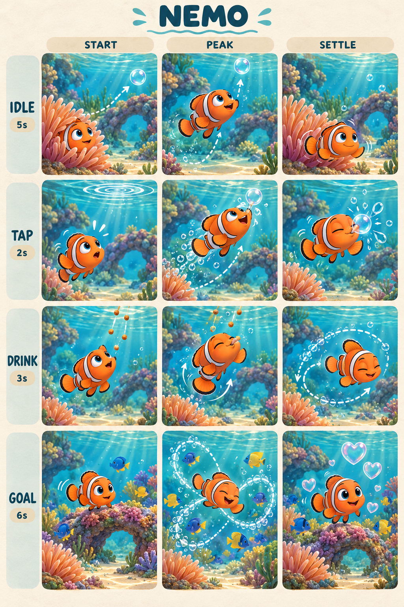
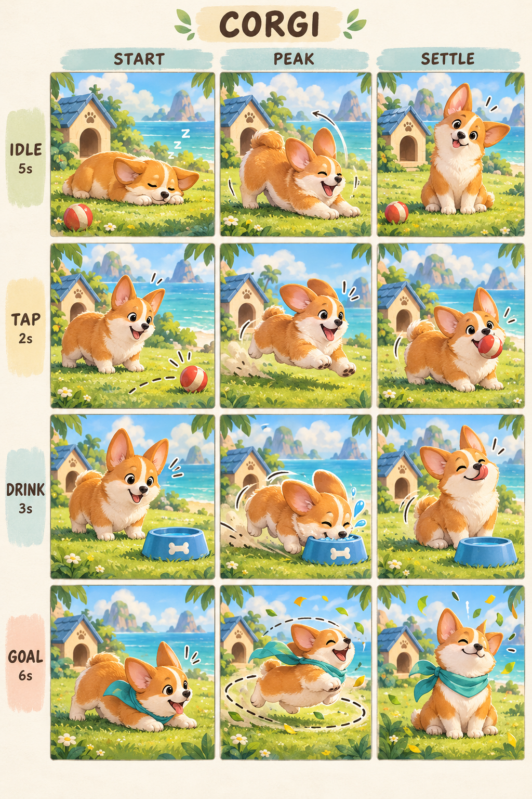
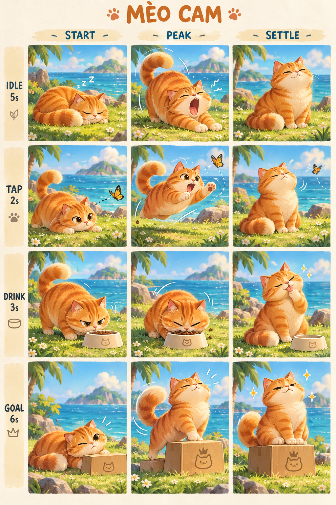

# Storyboard thú cưng — bản 1

Bản minh họa để duyệt hoạt cảnh, chưa thay thế asset hoặc mã ứng dụng. Tên mặc định: **Nemo**, **Corgi**, **Mèo Cam**. Người dùng có thể đổi tên theo yêu cầu đã nêu; chức năng đó chưa được triển khai trong phạm vi storyboard.

## Cách đọc

Mỗi hình gồm 4 hàng, mỗi hàng là một hoạt cảnh. Ba cột START → PEAK → SETTLE tương ứng chuẩn bị → cao trào → kết thúc. Đây là khung hình chính, không phải sprite sheet hoặc bản animation đã chạy.

| Hàng | Kích hoạt | Thời lượng dự kiến | Nhịp ba phần |
|---|---|---|---|
| IDLE | Khi thú nghỉ trên màn hình | 5 giây | 0–1,5s / 1,5–3,5s / 3,5–5s |
| TAP | Chạm vào thú | 2 giây | 0–0,3s / 0,3–1,4s / 1,4–2s |
| DRINK | Ghi nhận uống nước thành công | 3 giây | 0–0,5s / 0,5–2s / 2–3s |
| GOAL | Lần đầu đạt mục tiêu ngày | 6 giây | 0–1s / 1–4,5s / 4,5–6s |

DRINK là sự kiện người dùng ghi nhận uống nước: thú nhận phần thưởng tương ứng. Hình bát ở bản Corgi hiện thiên về uống nước; khi sản xuất asset cần thống nhất thành bát thức ăn đúng cơ chế cho thú ăn.

## Nemo — tò mò, chuyển động mềm

- **IDLE:** ló khỏi hải quỳ → nhìn theo bong bóng đang nổi → quay về, vẫy vây nhẹ.
- **TAP:** nhận ra gợn nước → lao theo đường cong để đuổi bong bóng → chạm mũi làm bong bóng vỡ, nhìn người dùng.
- **DRINK:** nhìn viên thức ăn rơi → bơi lên đớp vui vẻ → lượn một vòng nhỏ rồi trở lại.
- **GOAL:** lấy đà cạnh san hô → bơi hình số tám cùng đàn cá nhỏ → dừng tự hào giữa bong bóng hình tim.

Điểm nhấn: mắt dẫn hướng trước thân, vây nhỏ rung riêng, đuôi và bong bóng trễ nhịp. Nemo luôn ở dưới nước. Khi sản xuất cần khóa thiết kế vây nhỏ nhất quán giữa mọi tư thế; ảnh concept chưa phải mẫu rig chuẩn.

## Corgi — hăng hái, vụng về đáng yêu

- **IDLE:** ngủ gác cằm → duỗi hai chân trước, nâng mông → ngồi nghiêng đầu nghe ngóng.
- **TAP:** thấy bóng lăn → chạy chân ngắn, tai nảy theo → ngậm bóng, chờ được khen.
- **DRINK:** tai dựng khi bát xuất hiện → chạy tới, trượt nhẹ rồi ăn → liếm mép, lắc mông vui vẻ.
- **GOAL:** hạ thấp người lấy đà → chạy vòng, bật nhảy nhỏ với khăn xanh bay → ngồi ưỡn ngực giữa lá tung nhẹ.

Điểm nhấn: thân nảy nhẹ trên chân ngắn, tai chuyển động trễ, lắc mông thay cho cử động đuôi lớn. Duy trì bốn chân và giải phẫu chó.

## Mèo Cam — lười biếng, bất ngờ, kiêu hãnh

- **IDLE:** cuộn tròn ngủ nắng → ngáp lớn và vươn vai → ngồi lim dim, đuôi cuộn nhẹ.
- **TAP:** rình bướm, hạ người tập trung → vồ nhanh với đuôi giữ thăng bằng → ngồi quay đi như chưa có chuyện gì.
- **DRINK:** ngửi bát ăn với vẻ nghi ngờ → ăn từng nhịp nhỏ → liếm chân, lau mặt thỏa mãn.
- **GOAL:** hé một mắt → bước lên thùng giấy như bục vinh quang → nâng cằm, chớp mắt chậm giữa ánh lấp lánh.

Điểm nhấn: chuyển từ chậm sang nhanh rồi chậm; biểu cảm mắt, ria và đuôi thay đổi rõ. Giữ bộ vằn cam nhất quán.

## Quy tắc chuyển động đề xuất để duyệt

- Không lặp toàn bộ cảnh IDLE liên tục. Xen thở, chớp mắt, vẫy vây/tai/đuôi; cách nhau khoảng 12–20 giây mới phát một cảnh đặc trưng, có biến thể và khoảng nghỉ.
- TAP chỉ chạy một lần mỗi lần chạm; không xếp hàng nhiều lần chạm.
- Ghi nhận nước có hiệu lực ngay, không phải chờ hoạt cảnh. DRINK có thể thay TAP/IDLE; GOAL phát sau DRINK và chỉ một lần/ngày.
- Cảnh GOAL có thể bỏ qua. Không yêu cầu uống thêm để xem lại và không phạt thú khi người dùng bỏ lỡ nhắc nhở.
- Nếu bật giảm chuyển động, dùng đổi tư thế và chuyển mờ ngắn; tránh chạy vòng, nhảy hoặc hiệu ứng dày.
- Các thời lượng là định hướng để duyệt; cần kiểm tra nhịp thực tế trên điện thoại trước khi chốt animation.

## Phạm vi tiếp theo cần duyệt riêng

Chốt tạo hình và hoạt cảnh → tạo asset tách nền/rig hoặc chuỗi frame → tích hợp trạng thái và đổi tên → kiểm tra hiệu năng Android/iOS. Storyboard này chưa thực hiện các bước đó.

Ảnh được tạo bằng công cụ tạo ảnh tích hợp. Prompt nằm trong [prompts.md](prompts.md).
